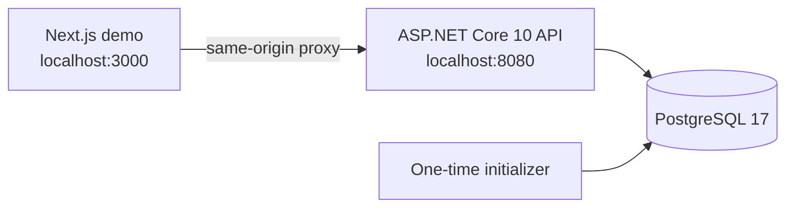

# JobsMarketplace

JobsMarketplace is a local-first subcontractor marketplace demonstration. A customer posts work, a contractor makes a private price offer, and the customer awards exactly one offer. The repository focuses on the C# HTTP API: authorization, validation, data integrity, search, and concurrent award handling.



## Start the demo

Prerequisites: Git, Docker Desktop (or Docker Engine with Compose), and internet access for the first image/package download.

```bash
git clone <repository-url>
cd jobs-marketplace
docker compose up --build
```

Open [http://localhost:3000](http://localhost:3000). API reference is at [http://localhost:8080/scalar](http://localhost:8080/scalar).

All ports bind to `127.0.0.1`; PostgreSQL has no host port. Normal restarts preserve the named database and data-protection-key volumes:

```bash
docker compose down
```

Resetting the demonstration database is destructive:

```bash
docker compose down --volumes
docker compose up --build
```

## Demo accounts

| Role | Email | Password |
|---|---|---|
| Customer | `customer1@marketplace.test` | `Demo!12345` |
| Customer | `customer2@marketplace.test` | `Demo!12345` |
| Contractor | `contractor1@marketplace.test` | `Demo!12345` |
| Contractor | `contractor2@marketplace.test` | `Demo!12345` |

The initializer creates 200 customers, 50 contractors, 120 jobs, and a representative set of offers. It performs no work on later starts once profiles exist, so normal starts do not duplicate data.

## Inspect the database?

PostgreSQL deliberately has **no host port** in `compose.yaml`; it is reachable
only from the Compose network. That keeps the local demonstration database out
of the host network while still making it easy to inspect through Docker.

Confirm the stack is ready, then open a PostgreSQL shell in the database
container:

```bash
docker compose ps
docker compose exec db psql -U marketplace -d marketplace
```

Useful `psql` commands:

```sql
\dt
SELECT id, first_name, last_name FROM customers LIMIT 10;
SELECT id, description, status FROM jobs LIMIT 10;
SELECT id, job_id, contractor_id, price FROM job_offers LIMIT 10;
\q
```

To browse tables with a local GUI such as pgAdmin or DBeaver, temporarily add
the following under the `db` service in `compose.yaml`, then run
`docker compose up -d`:

```yaml
ports:
  - "127.0.0.1:5432:5432"
```

Connect the GUI to `localhost:5432` with database, username, and password all
set to `marketplace`. Remove the temporary port mapping when finished.

## Five-minute walkthrough

1. Sign in as `customer1@marketplace.test`; create a job using the right-hand form.
2. Sign out and sign in as `contractor1@marketplace.test`; find the job, open it, and submit an offer.
3. Sign out and sign in as the customer; open the job and accept the offer.
4. Refresh or retry acceptance: the same offer is safe to retry, while a different offer returns `409 Conflict`.

The Next.js application calls the API through a fixed same-origin `/backend` rewrite. It has no direct database access.

## API

All endpoints are under `/api/v1`. OpenAPI JSON is served by the API and Scalar renders it at `/scalar`. `marketplace.http` contains a small request collection for clients such as VS Code REST Client.

| Route | Purpose |
|---|---|
| `GET /customers?lastName=sm` | Customer search: two characters use prefix search; three or more use substring search. |
| `GET /contractors?name=build` | Contractor name search. |
| `GET/POST /jobs`, `GET/PUT/DELETE /jobs/{id}` | Job browse and customer-owned CRUD. |
| `GET/POST /jobs/{id}/offers` | Customer-visible or contractor-owned offer collection. |
| `PUT/DELETE /jobs/{id}/offers/{offerId}` | Contractor-owned offer changes while the job is open. |
| `POST /jobs/{id}/offers/{offerId}/accept` | Atomically awards an offer to the job owner. |

All ID values serialize as strings so JavaScript never loses `bigint` precision. Lists use `{ items, nextCursor }`, default to 20, and are capped at 100. Browser write calls first obtain `/auth/csrf` and send its cookie value as `X-XSRF-TOKEN`.

### Test authenticated endpoints in Scalar

Scalar is served at [http://localhost:8080/scalar](http://localhost:8080/scalar).
The API uses cookie authentication plus double-submit CSRF protection, so use
these steps before testing a protected endpoint in Scalar:

1. Execute `GET /api/v1/auth/csrf` and copy the `token` from its JSON response.
2. Execute `POST /api/v1/auth/login` with header
   `X-XSRF-TOKEN: <copied token>` and this body:

   ```json
   {
     "email": "customer1@marketplace.test",
     "password": "Demo!12345"
   }
   ```

   A successful login returns `204 No Content` and stores the authentication
   cookie in the browser.
3. Execute `GET /api/v1/customers?lastName=sm&limit=20`. It returns `200 OK`
   when the authentication cookie is present. Any demo account can make this
   authenticated read.

The login endpoint is rate-limited to five attempts per minute per IP. For a
scriptable version of the same flow, use the request sequence in
`marketplace.http` with a REST client that preserves cookies.

## Design choices

- `Marketplace.Core` owns shared domain terms and pure helpers.
- `Marketplace.Persistence` owns Entity Framework entities, PostgreSQL mappings, constraints, and indexes.
- `Marketplace.Api` owns HTTP contracts, Identity, authorization, rate limits, cache, initialization, and endpoints.
- `numeric(18,2)` stores PHP amounts exactly. Domain tables use generated `bigint` IDs, `date` for job dates, and UTC timestamps for audit data.
- Exact profile ID lookup uses primary keys. Name searches use normalized values, capped inputs, escaped `LIKE` patterns, and PostgreSQL `pg_trgm` GIN indexes for substring queries.
- Offer creation, offer changes, job changes, and acceptance lock the parent job in a serializable transaction. This prevents an offer from changing or being accepted while a competing mutation passes the business-state check.
- Profile-by-ID DTOs use an in-process 1,000-entry LRU cache with a 60-second TTL. It never caches permissions, credentials, job state, or award decisions. A multi-replica deployment would need a shared cache only after measurement shows it is worthwhile.

## Security implemented

- ASP.NET Core Identity password hashing, account lockout, role-based endpoint access, and profile ownership checks.
- HttpOnly authentication cookies, `SameSite=Lax`, production-only `Secure`, and double-submit CSRF validation on every unsafe browser request.
- Bounded query inputs and page size, request body limit, header timeout, database command timeout, parameterized EF Core queries, and mass-assignment-safe DTOs.
- Per-IP read limiting, tighter login and write policies, safe generic 500 responses, and structured seed logging without request bodies or credentials.

The local stack is intentionally HTTP-only for reviewer convenience. A public deployment must enable HTTPS, secure-cookie mode, trusted-proxy configuration, protected shared data-protection keys, secrets management, a web application firewall/CDN, and shared rate enforcement. In-process rate limiting reduces individual-client abuse but cannot defend a distributed denial-of-service attack by itself.

## Verification

Run the fast unit tests locally with the .NET SDK:

```bash
dotnet test JobsMarketplace.sln --configuration Release
```

The included GitHub Actions workflow builds the frontend and runs backend tests. Before submitting, run `docker compose up --build` on a clean checkout and complete the walkthrough above. For a performance record, use a five-minute, 50-concurrent-user test against the local API, record machine resources, dataset size, p50/p95 latency, errors, connection usage, and cache behavior in your submission notes.

The normal demonstration dataset and a local test are evidence that search paths and constraints are designed to scale. They are not proof of capacity for 10 million customers; that requires production-sized data, an environment representative of the target host, monitoring, and load testing.
